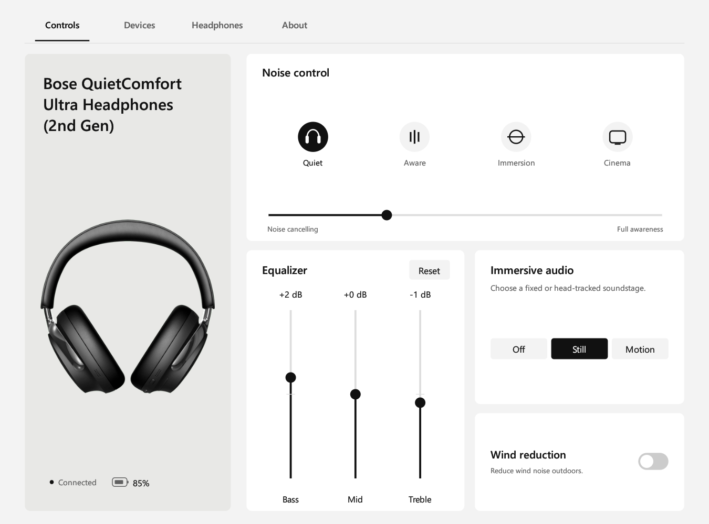

# Bose Headphone Control

A Windows app for controlling Bose QuietComfort headphones.

[简体中文](README.zh-CN.md) · [Contributing](CONTRIBUTING.md) · [Language packs](docs/languages.md)



## Features

- Listening modes, noise cancellation, three-band equalizer, immersive audio and wind reduction.
- Paired devices, multipoint connection, wearing detection and call settings.
- English and Simplified Chinese, with the system language selected by default.
- Tray controls to reopen the window or quit the app.

Tested with **Bose QuietComfort Ultra Headphones (2nd Gen)**. Other models are untested. Available controls depend on the headphones and firmware.

## Headphone firmware

**Bose QuietComfort Ultra Headphones (2nd Gen) requires firmware newer than 10.12.12.**

- **Mobile:** Use the Bose app to check and update the headphone firmware.
- **PC:** Open [Bose Updater](https://btu.bose.com/), install the updater when prompted, and connect the headphones with a USB data cable. Follow the on-screen instructions to check for and install updates.

## Use

Download the Windows x64 ZIP from [Releases](https://github.com/qianzhouyi2/bose-headphone-control/releases/latest), extract it, and run `bose-headphone-control.exe`.

Requires Windows 10/11, a Bluetooth adapter and headphones paired in Windows Settings. Run `bose-headphone-control.exe` to connect.

The Devices page shows connection and playback-source status. **Disconnect** removes the Bluetooth connection without deleting the pairing.

**PC Bluetooth requirement:** The Bluetooth adapter and its driver must support BLE/GATT. If audio playback works but the app cannot connect, also check for a Bluetooth driver update from your PC manufacturer.

The BLE management connection is separate from LE Audio. The app does not require the Windows LE Audio option to be enabled.

Closing the window keeps the app in the tray. Click the tray icon to reopen it, or right-click it to quit. Launching the app again opens the existing window.

Change the display language under **About headphones → Language**. Preferences and logs are stored in `%LOCALAPPDATA%\Quiet Rebellion`, retained for compatibility with earlier builds.

## Build

Install stable Rust with the MSVC toolchain, Visual Studio C++ Build Tools and the Windows SDK. From the project directory, run:

```powershell
cargo build --release --locked
```

The executable is written to `target/release/bose-headphone-control.exe`. No installer is required. Both display languages are built into the executable.

## Current limitations

The app uses Bluetooth LE; RFCOMM is not supported. Available controls depend on the headphone model and firmware.

## License

[MIT](LICENSE). Based on the Quiet Rebellion client and protocol work from [aaronsb/bosectl](https://github.com/aaronsb/bosectl). The original license notices are retained.

Bose is a trademark of its owner. This is an unofficial project, unaffiliated with Bose Corporation.

The headphone product image belongs to Bose and is excluded from the MIT license. Its source is listed in [LICENSE](LICENSE).
