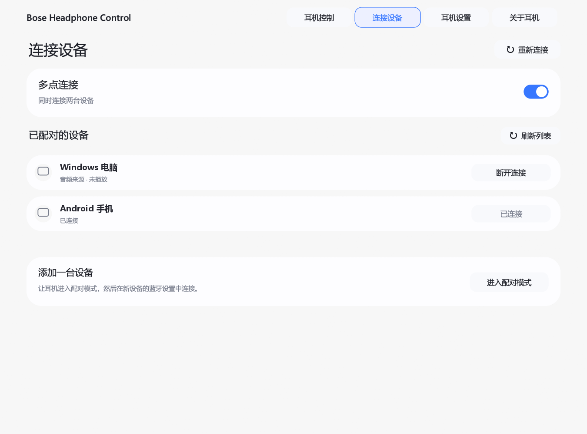

# Bose Headphone Control

用于控制 Bose QuietComfort 耳机的 Windows 应用。

[English](README.md) · [参与开发](CONTRIBUTING.md) · [添加语言](docs/languages.md)



## 功能

- 聆听模式、降噪、三段均衡器、沉浸式音频和抗风噪。
- 已配对设备、多点连接、佩戴检测和通话设置。
- 简体中文和英语，默认跟随系统语言。
- 托盘打开窗口和退出。

目前测试的型号为 **Bose QuietComfort Ultra Headphones (2nd Gen)**。其他型号尚未测试；可用功能取决于耳机型号和固件。

## 耳机固件版本

**Bose QuietComfort Ultra Headphones (2nd Gen) 的固件版本需高于 10.12.12。**

- **手机升级：** 通过 Bose App 查看并更新耳机固件。
- **电脑联网升级：** 在浏览器打开 [Bose Updater](https://btu.bose.com/)，按提示安装升级程序，用 USB 数据线连接耳机后，按网页提示检查并安装更新。

## 使用

需要 Windows 10/11、蓝牙适配器，以及已在 Windows 设置中完成配对的耳机。运行 `bose-headphone-control.exe` 后自动连接。

「设备」页面会显示连接状态和播放来源。「断开连接」只会断开蓝牙，不会删除配对记录。

**电脑蓝牙要求：** 蓝牙适配器及其驱动需要支持 BLE/GATT。耳机能播放音频但应用无法连接时，也请检查电脑厂商提供的蓝牙驱动更新。

BLE 管理连接与 LE Audio 是不同功能；本应用不要求开启 Windows 的「LE Audio」选项。

关闭窗口后应用继续在托盘运行。点击托盘图标打开窗口，右键菜单可退出。再次启动应用会打开已有窗口。

在「关于耳机 → 语言」中切换界面语言。设置和日志保存在 `%LOCALAPPDATA%\Quiet Rebellion`，沿用此目录以兼容早期版本。

## 构建

安装 stable Rust（MSVC 工具链）、Visual Studio C++ Build Tools 和 Windows SDK。在项目目录执行：

```powershell
cargo build --release --locked
```

生成的程序位于 `target/release/bose-headphone-control.exe`。无需安装即可运行，中英文语言包已内置。

## 已知限制

目前通过低功耗蓝牙连接，不支持 RFCOMM。可用控制功能取决于耳机型号和固件。

## 许可

[MIT](LICENSE)。基于 Quiet Rebellion 客户端和 [aaronsb/bosectl](https://github.com/aaronsb/bosectl) 的协议工作，保留原始许可声明。

Bose 为其权利人的商标。本项目为非官方项目，与 Bose Corporation 无隶属关系。

耳机产品图归 Bose 所有，不属于 MIT 许可范围，来源见 [LICENSE](LICENSE)。
